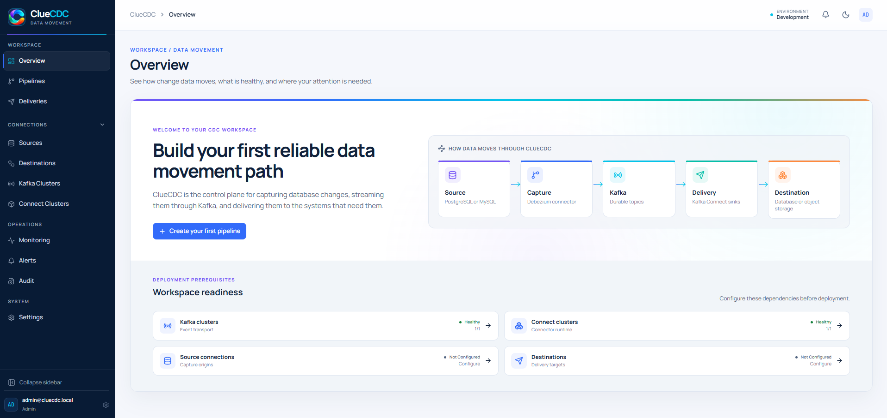

<p align="center">
  
</p>

<h1 align="center">ClueCDC</h1>

[](https://github.com/cluedata/cluecdc/actions/workflows/ci.yml)
[](https://cluedata.github.io/cluecdc/)
[](LICENSE)

ClueCDC is an open-source platform for managing Change Data Capture (CDC)
pipelines powered by Debezium, Apache Kafka, and Kafka Connect.

Use the web UI or API to configure connections, deploy pipelines, deliver data,
and monitor operations. Debezium and Kafka Connect handle data replication.

## Features

- **CDC pipelines:** PostgreSQL and MySQL discovery, readiness checks, and capture.
- **Data delivery:** PostgreSQL/MySQL JDBC sinks and AWS S3/MinIO event logs.
- **Pipeline operations:** snapshots, table selection, pause, resume, and recovery.
- **Data Quality:** read-only checks for comparable PostgreSQL/MySQL datasets.
- **Observability:** pipeline health, lag measurements, event samples, and alerts.
- **Access control:** session authentication, Admin/Ops/Viewer roles, encrypted
  credentials, and audit history.

See the [feature matrix](docs/features.md) for supported capabilities and limits,
including experimental sources and warehouse integrations.

<p align="center">
  
</p>

## Quick Start

Requires Git, Python 3.12+, Docker with Linux containers, and Docker Compose
v2.24.7+ or v5. Allocate at least 6 GB of Docker memory.

```bash
git clone https://github.com/cluedata/cluecdc.git
cd cluecdc
cp .env.example .env
docker compose up -d --build --wait
```

For a new installation, `bootstrap.py` creates `.env` with a local database
password and independent encryption, session, and service secrets. It preserves
existing values. Keep this file private. Use `python3` or `py -3` if required
by your system.

Open the [Web UI](http://localhost:3000/login) or
[API reference](http://localhost:8000/docs).

Development login: `admin@cluecdc.local` / `cluecdc-admin`.
The default account and Compose configuration are for local use.

The local stack includes the web UI, API, background worker, metadata PostgreSQL,
Kafka, and Kafka Connect. Register `kafka:29092` and `http://kafka-connect:8083`
in **Infrastructure**, then follow the [first pipeline guide](docs/getting-started/first-pipeline.md).

For an existing installation, keep `.env`, the Compose project name, and
persistent volumes. Follow the [upgrade instructions](docs/operations/configuration.md#existing-installations).

## Demo and Testing

After the initial setup, add sample PostgreSQL and MySQL source/destination
databases with the demo extension:

```bash
docker compose -f docker-compose.yml -f docker-compose.demo.yml up -d --build --wait
```

Run the capture and delivery demonstrations:

```bash
python scripts/demo.py
python scripts/demo-destination.py --skip-capture-demo
```

These scripts register demo resources and verify real data flow. Optional MinIO,
workload generation, and additional source profiles are described in the
[Compose guide](docs/getting-started/docker-compose.md).

Integration and browser tests use the same demo topology. Run them in an isolated
Compose project to protect existing data; see the [testing guide](docs/development/testing.md)
for commands and cleanup.

## Kubernetes

The repository includes a [Kustomize deployment baseline](deploy/kubernetes/README.md)
for the web UI, API, and workers. PostgreSQL, Kafka, Kafka Connect, and production
secrets must be provided separately.

See the [Kubernetes guide](docs/deployment/kubernetes.md) for prerequisites,
validation, migrations, and rollout instructions.

## Documentation

- [Installation and prerequisites](docs/getting-started/installation.md)
- [Docker Compose](docs/getting-started/docker-compose.md)
- [First pipeline](docs/getting-started/first-pipeline.md)
- [Architecture](docs/architecture/overview.md)
- [Configuration](docs/operations/configuration.md)
- [Data Quality](docs/operations/data-quality.md) and [Monitoring](docs/operations/monitoring.md)
- [Troubleshooting](docs/operations/troubleshooting.md)
- [Development](docs/development/setup.md) and [Testing](docs/development/testing.md)
- [Full documentation](https://cluedata.github.io/cluecdc/)

## Roadmap

See [ROADMAP.md](ROADMAP.md) for planned improvements and project priorities.

## Project Policies

- [Contributing](CONTRIBUTING.md)
- [Security](SECURITY.md)
- [Support](SUPPORT.md)
- [Governance](GOVERNANCE.md)
- [Code of Conduct](CODE_OF_CONDUCT.md)

See [CHANGELOG.md](CHANGELOG.md) for release history and
[RELEASES.md](RELEASES.md) for the release process.

## Donation

For financial support inquiries, contact the maintainers through [Support](SUPPORT.md).

## License

[Apache License 2.0](LICENSE). See [NOTICE](NOTICE) for bundled attribution.
