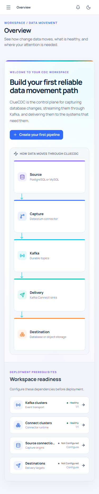
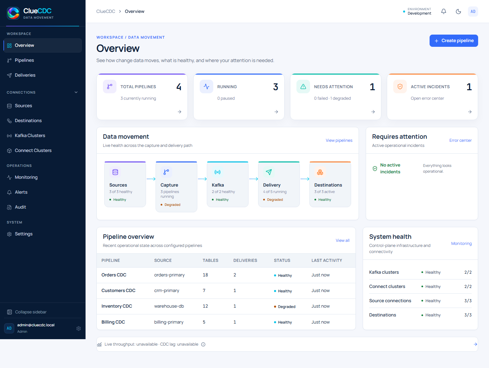

# ClueCDC v0.3.0 visual redesign revision

Status: **implemented and release-tested**
Scope: **Application Shell + Overview only**

This revision applies the **ClueCDC Spectrum Workspace** direction to the application shell and Overview. No other product page was redesigned in this revision.

## Visual audit

| Area                | Before revision                                                                                                         | Revision response                                                                                                                                                   |
| ------------------- | ----------------------------------------------------------------------------------------------------------------------- | ------------------------------------------------------------------------------------------------------------------------------------------------------------------- |
| Hierarchy           | Overview relied on flat text regions and a divider-style summary. The primary task was not visually dominant.           | A stronger page title, one focused onboarding surface, bounded KPI cards, and a deliberate primary/secondary panel hierarchy establish clear reading order.         |
| Zero-pipeline state | Empty information was distributed across multiple independent regions, creating a sparse dashboard without a next step. | The zero state is one first-class onboarding experience: product explanation, one primary CTA, a five-stage CDC flow, and only actionable infrastructure readiness. |
| Populated state     | Runtime health was summarized, but pipeline inventory and the end-to-end movement model were visually weak.             | Four KPI cards lead into a five-stage operational flow, real pipeline inventory, incident handling, and infrastructure health. No product metric is fabricated.     |
| Typography          | Small labels and similar visual weights made the 1440 px layout feel under-scaled.                                      | Page title, onboarding headline, section headings, body copy, and technical values now use distinct sizes and weights.                                              |
| Surfaces            | Large areas read as one flat canvas, especially in dark mode.                                                           | Canvas, cards, secondary surfaces, elevated surfaces, and the sidebar have distinct semantic tokens in both themes.                                                 |
| Brand               | Blue and cyan carried most of the identity; violet, teal, and orange were underused.                                    | The five spectrum accents map to the five data-movement stages and KPI categories. Gradients are limited to the onboarding rail and flow connectors.                |
| Navigation          | The active sidebar item used a large blue slab and the product mark had weak hierarchy.                                 | The active state uses a quiet navy surface with a narrow spectrum indicator. The product block now includes a contained mark, wordmark, and descriptor.             |
| Density             | Empty and populated workspaces shared too much structure, leaving avoidable whitespace.                                 | Empty and populated states render different information architectures. Empty operational panels are suppressed when they have no useful content.                    |

## Reviewed states

The pre-revision findings remain documented in the audit table above. The image
set below is regenerated from the approved brand assets so no documentation
screenshot retains the temporary fallback mark.

### Zero-pipeline desktop light

### Zero-pipeline desktop dark

### Zero-pipeline mobile

### Populated desktop

The populated screenshot uses a deterministic visual-test fixture so the full state can be reviewed without mutating the local environment. Production UI continues to read the real Overview and pipeline APIs.

## Implementation decisions

- The zero-pipeline Overview makes no incident, activity, metric, or inventory request until pipelines exist.
- Workspace readiness reports only source, destination, Kafka, and Connect configuration returned by the API.
- Viewer and Ops roles continue to receive permission-appropriate content; infrastructure and incident details remain Admin-only.
- The existing navigation information architecture and collapse/drawer behavior were retained.
- The supplied transparent ClueCDC logo replaces the temporary Git-branch product mark in the application shell and authentication surface. The square icon is used for favicon and social metadata.
- Dark mode uses separate canvas, primary surface, secondary surface, elevated surface, sidebar, and border tokens rather than one uniform navy.

## Verification

- Frontend tests: 18 files, 50 tests passed.
- TypeScript: passed.
- ESLint: passed.
- Production build: passed.
- Browser visual check: 1440 px light, 1440 px dark, 375 px light, and populated 1440 px light passed with no page-level horizontal overflow or page errors.

## Review gate

Implementation intentionally stops at the Application Shell and Overview. Approval is required before this visual system is propagated to Pipelines, Deliveries, Connections, Monitoring, Alerts, Audit, or Settings.
