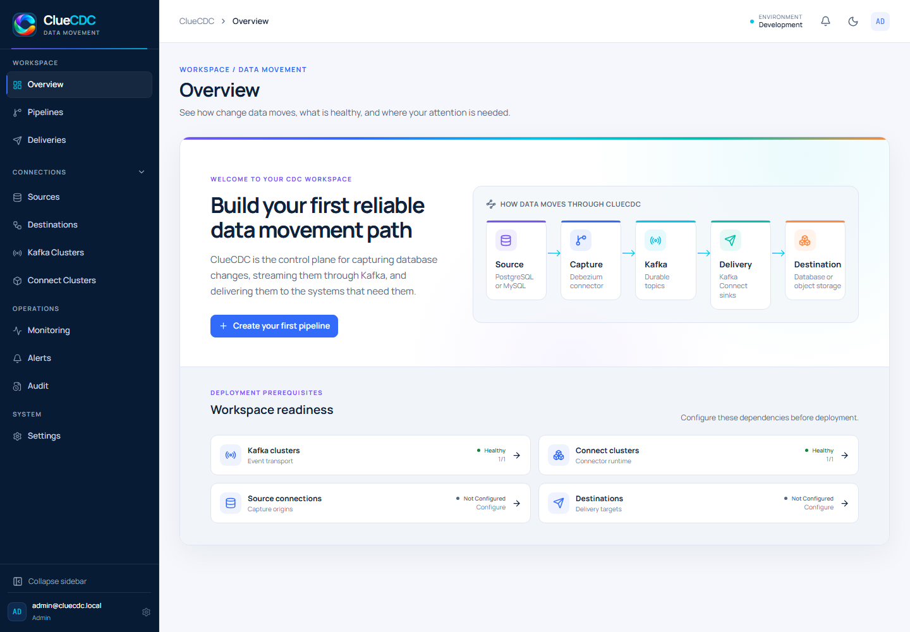
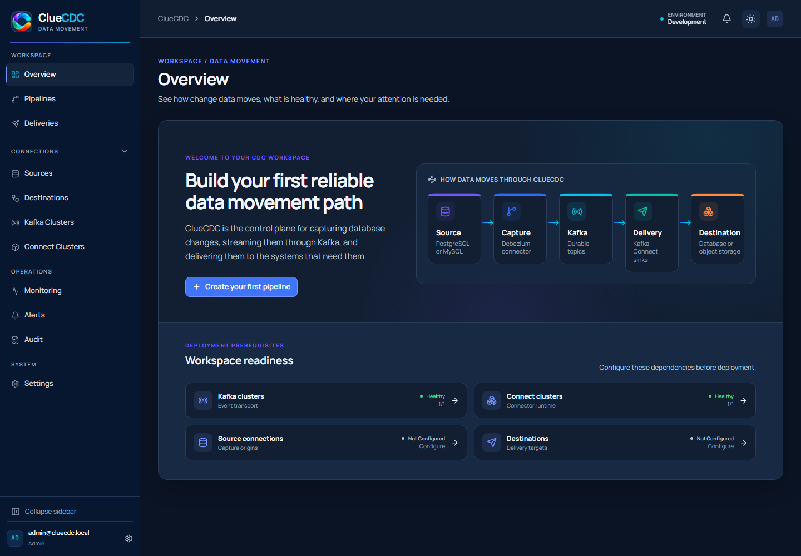
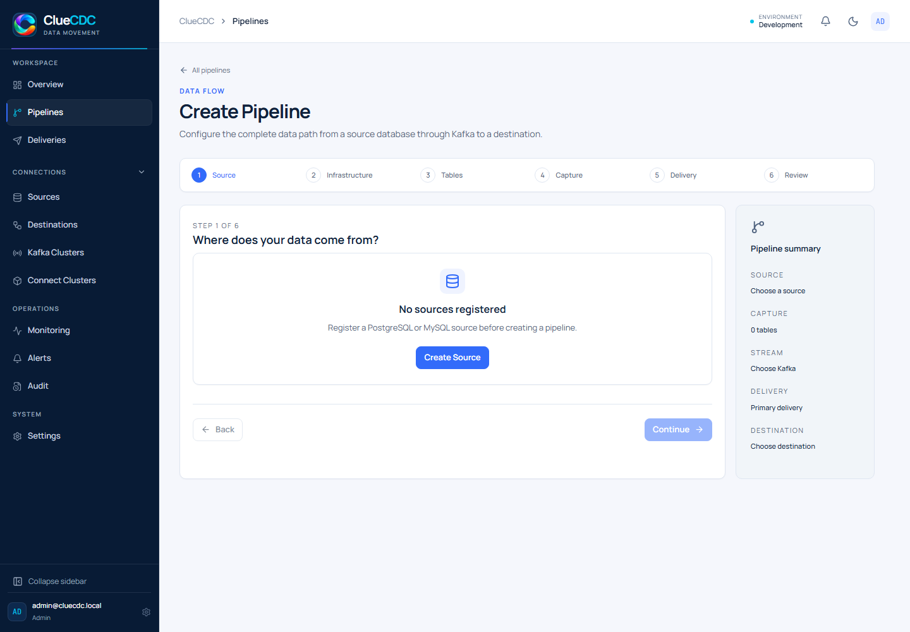
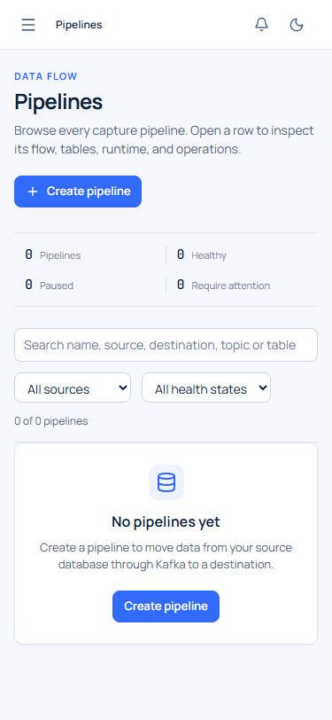
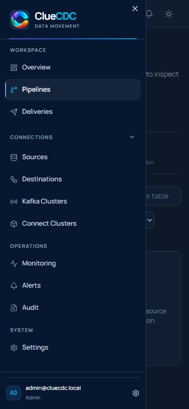

# ClueCDC v0.3.0 — UX/UI Redesign

ClueCDC v0.3.0 refreshes the control-plane experience for day-to-day Data
Engineering work while preserving existing CDC workflows, routes, and
Viewer/Ops/Admin authorization boundaries.

## Highlights

- A clearer operator workspace puts pipeline health, recent activity, and
  common actions at the center of the product.
- Dense operational screens now share consistent loading, empty, error, and
  status treatments across desktop and mobile layouts.
- The supplied multicolor ClueCDC artwork is used consistently in the
  application, authentication screen, browser metadata, and documentation.

## Design System

- The Clean Tech Spectrum / Spectrum Workspace identity combines neutral
  operational surfaces with brand-aligned blue, cyan, and purple accents.
- Semantic tokens separate interaction, surface, border, typography, focus,
  and operational-status colors so state does not depend on brand color.
- Complete light and dark themes use consistent typography, spacing, forms,
  tables, dialogs, badges, focus treatment, and status indicators.
- Brand images retain their aspect ratio and are sized by their surrounding UI
  context to avoid distortion.

## Navigation & User Experience

- The redesigned application shell provides a persistent desktop sidebar, a
  compact collapsed state, and a mobile navigation drawer.
- Sources, Destinations, Kafka Clusters, and Kafka Connect Clusters are grouped
  under a collapsible Connections section.
- Navigation remains role-aware: Viewer, Ops, and Admin users see only the
  destinations their existing permissions allow.
- Existing URLs remain compatible, and the shell adapts to narrow viewports
  without page-level horizontal overflow.

## Pipeline Experience

- Pipeline inventories and details present health, topology, deliveries, and
  lifecycle actions with clearer hierarchy and feedback.
- Pipeline creation is organized into six steps: Source → Infrastructure →
  Tables → Capture → Delivery → Review.
- Moving backward retains entered values, validation is shown in context, and
  deployment still begins only from the explicit final review action.
- Existing backend deployment semantics are preserved; the redesign does not
  create duplicate pipelines during step navigation.

## Operational Experience

- Overview emphasizes real resource counts, pipeline state, delivery state,
  recent failures, and audit activity without inventing unavailable metrics.
- Monitoring, Alerts, Deliveries, Connections, Settings, and administration
  screens use the same compact information hierarchy and responsive patterns.
- Kafka and Kafka Connect forms now offer an on-demand connection test.
  Background worker checks persist each cluster's latest observed status,
  reason, and timestamp so newly configured infrastructure can move out of an
  unknown/degraded state when it becomes reachable.

## Quality & Compatibility

- Frontend component coverage includes navigation, themes, the six-step wizard,
  operational views, infrastructure connection tests, and responsive states.
- API coverage includes infrastructure probes, persisted health observations,
  worker scheduling, RBAC, and existing control-plane behavior.
- Release validation covers formatting, TypeScript, ESLint, Python lint/type
  checks, production builds, strict documentation, dependency audits, Compose
  rendering, and version/deployment metadata.
- Browser acceptance captures the principal routes in light/dark desktop and
  mobile layouts and checks page errors, overflow, brand sizing, and live
  Kafka/Kafka Connect form tests.
- Automated checks support but do not by themselves establish WCAG 2.2 AA
  conformance.

## Upgrade Notes

- Upgrade from `v0.2.1` by deploying the `0.3.0` API/worker, web, and Connect
  images together and running `alembic upgrade head` before normal operation.
- Alembic revision `0007` adds nullable `status_reason` and
  `last_health_check_at` columns to `kafka_clusters` and `connect_clusters`.
  Existing cluster registrations and encrypted credentials are preserved.
- `INFRASTRUCTURE_HEALTH_INTERVAL_SECONDS` is a new optional worker setting.
  It defaults to 30 seconds and accepts values from 5 to 3600 seconds.
- Kubernetes manifests are pinned to `0.3.0`; the worker intentionally uses the
  API image. Review and reapply the updated ConfigMap and workload manifests.
- No existing public route is removed. Kafka and Kafka Connect response objects
  gain nullable health-reason and last-check fields, and Admin-only connection
  test endpoints are added.

## Known Limitations

- Screen-reader announcements, platform-specific high-contrast modes, and the
  complete manual WCAG 2.2 AA matrix still require human validation in target
  browsers and assistive technologies.
- Throughput and CDC-lag values remain unavailable until a metrics provider is
  configured; the UI labels this state instead of displaying fabricated data.
- Final live CDC, target-cluster Kubernetes, container vulnerability, and
  release-candidate workflow evidence must be reviewed for the exact approved
  commit before tagging.

## Interface Previews

### Overview

### Pipeline Workflows

